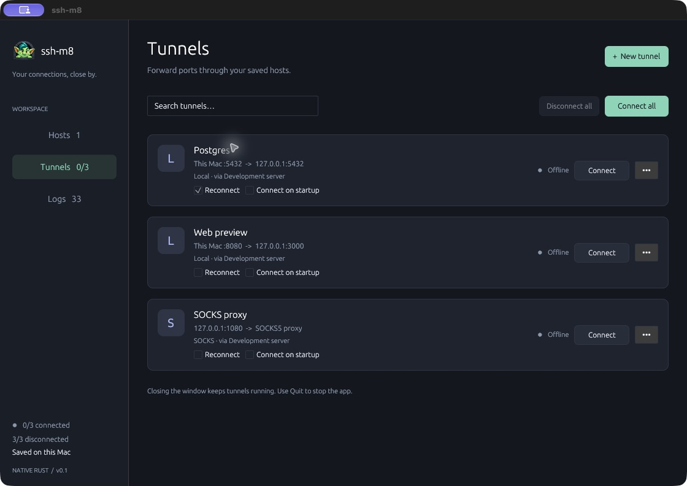

<p align="center">
  
</p>

<h1 align="center">ssh-m8</h1>
<p align="center"><strong>A small macOS home for your SSH hosts and tunnels.</strong><br>Trolls live in tunnels. This one looks after yours.</p>
<p align="center">Rust · macOS · OpenSSH · MIT</p>



Save a host, set up a forward, and get on with your work. ssh-m8 keeps the familiar parts close: connection details, passwords, tunnel status, and logs. The troll in the menu bar brings the window back when you need it.

## What it does

| Hosts | Tunnels | Everyday use |
| --- | --- | --- |
| Saved addresses, users, ports, and key paths | Local, remote, and SOCKS5 forwarding | Connect all / Disconnect all |
| Passwords in macOS Keychain | Optional connection on app startup | Connected / total and disconnected / total counts |
| Interactive SSH in macOS Terminal | Optional retries every 30 seconds | Menu bar icon and recent connection logs |

The interface is native Rust with egui/eframe. It needs no account, sync service, telemetry, embedded browser, or local web server. SSH itself is handled by the OpenSSH executable supplied with macOS.

## Download installer

Release packaging includes a small, prebuilt app archive and a one-line installer. Users do not need Rust, Xcode, Homebrew, or sudo. The current Apple Silicon app is about **4.8 MB compressed**, or **7.8 MB installed**; sizes vary between releases.

The installer puts the app in `~/Applications/ssh-m8.app` and its CLI link in `~/.local/bin/ssh-m8`. It verifies the archive's pinned SHA-256 checksum and the app's signature, preserves saved connections and credentials, and leaves the app closed. Quit ssh-m8 before updating; the installer will not stop running tunnels for you. Add `~/.local/bin` to your shell's `PATH` to use the CLI.

Install the current release (v0.1.0, Apple Silicon) with:

```sh
curl -fsSL 'https://github.com/apps-m8/ssh-m8/releases/download/v0.1.0/install-arm64.sh' | sh
```

Only use the command from the project's own release page. You can download and read the script before running it. Intel Macs need a separately built `install-x86_64.sh` release. The installer checks the Mac's architecture before downloading.

The app is locally signed, not notarised. The installer marks it as an internet download so macOS keeps its first-open checks. Open the app from your Applications folder; if macOS blocks it and you trust the release, follow Apple's [Open Anyway instructions](https://support.apple.com/102445). Managed Macs may prevent this. The installer does not change Gatekeeper settings or remove quarantine attributes.

## Build and run

Requires **macOS 12 or later**, the Xcode Command Line Tools, and a current stable Rust toolchain. This project targets macOS; other operating systems are not supported yet.

```sh
# From the repository directory:
cargo run --release --locked

# Or build a standalone Mac app:
sh scripts/build-app.sh
open dist/ssh-m8.app
```

Move `dist/ssh-m8.app` into Applications if you want to keep it there. The build script signs the app locally. It is not Developer ID signed or notarized, so it is not a ready-made public binary distribution.

`scripts/cargo.sh` also works with a project-local Rust toolchain if present. No toolchain or build output is included in the repository.

Maintainers can generate a release archive and its installer with [the packaging instructions](CONTRIBUTING.md#packaging-a-release).

## CLI and AI agents

The app includes a native CLI. It controls the running window's hosts and tunnels, returns JSON by default, and uses the same saved credentials. No browser automation or separate server is needed.

```sh
# After building the app, add its executable to ~/.local/bin:
sh scripts/install-cli.sh

# If you moved the app, pass its location instead:
sh scripts/install-cli.sh /Applications/ssh-m8.app

# Ensure ~/.local/bin is on PATH, then:
ssh-m8 --help
ssh-m8 agent-help
ssh-m8 status
ssh-m8 hosts list
ssh-m8 tunnels connect all
ssh-m8 logs --limit 30
```

Keep ssh-m8 open while using commands. The installer creates a symlink; rerun it if you move the app. You can also call `dist/ssh-m8.app/Contents/MacOS/ssh-m8` directly. Commands do not open a second GUI or create a second set of tunnels.

The CLI supports adding, editing, and removing hosts/tunnels, connecting one or all tunnels, changing startup/retry options, opening Terminal sessions, and setting or clearing passwords through stdin. Passwords cannot be read back. Connection commands are asynchronous; query status to confirm the result.

See the [agent guide](docs/agents.md) for commands, JSON responses, exit codes, and safe automation examples. The same guide is available offline through `ssh-m8 agent-help`; [AGENTS.md](AGENTS.md) points repository agents to it.

## Connect something

1. **Add a host.** Enter a hostname, IP address, or an alias from your SSH configuration. Leave the username blank to use your SSH configuration. Set the SSH port explicitly.
2. **Choose authentication.** Use your SSH agent, a private key path, or a saved password. Existing passwords are preserved when an edit leaves the password field blank.
3. **Verify the host.** Use **Open terminal** once to check a new server's fingerprint. Background tunnels only connect to already trusted hosts.
4. **Add tunnels.** Pick the SSH host, forwarding type, and ports. **Connect all** includes tunnels hidden by search and skips ones already connecting or running.
5. **Check the logs.** The latest 300 events show connection failures, retries, and status changes. Logs stay in memory for the current session.

### Startup and reconnection

Both options are saved per tunnel and are off by default. Use the checkboxes directly on each tunnel card; changes save immediately, even while connected. They are also available in **Edit tunnel**:

- **Connect on startup:** connect when ssh-m8 opens. It does not install a login item or system service.
- **Reconnect:** wait 30 seconds after a failed attempt or a detected disconnect, then try again. Turning it off cancels a pending retry and leaves a healthy connection running. Enabling it does not start an offline tunnel. The edit dialog calls this option **Keep retrying**. **Disconnect**, **Stop retrying**, and **Disconnect all** cancel pending retries until you connect again. A future app launch still follows the saved startup option.

Disconnect a tunnel before editing its host or forwarding route. Closing the window minimizes it and keeps tunnels running. The troll's menu bar badge shows connected/total tunnels, and its menu includes **Connect all tunnels**, **Disconnect all tunnels**, and **Open ssh-m8**. **Quit ssh-m8** or **Command-Q** stops the app and its tunnels. Terminal sessions are separate.

“Connected” means SSH established the forwarding listener. It does not prove the destination service is healthy. Connecting, retrying, failed, and offline tunnels count as disconnected until the listener is established.

## CPU and memory

ssh-m8 is built to spend most of its time asleep:

- The UI redraws for input and state changes, with no animation loop or dashboard refresh timer.
- A connected tunnel has **no periodic manager polling timer**. SSH output and process shutdown wake the worker; deadlines and retries use timed waits.
- One worker manages the tunnels. Each active SSH process has a small blocking output-reader thread. OpenSSH sends keepalives every 30 seconds and detects an unresponsive peer after missed responses; the retry delay starts after the disconnect is detected.
- Displayed logs and pending logs are each capped at 300 entries. Individual SSH log lines are capped at 2,000 bytes, and noisy debug output is discarded before waking the UI.
- Small logo textures are loaded once. Rendering uses no depth buffer, stencil buffer, or multisample antialiasing.
- The CLI adds one blocking listener thread. It wakes for local commands, with bounded messages and no idle polling. CLI invocations exit after their response and never initialize the graphics stack.

### Measurements

Release-build observations before the CLI listener was added, sampled at rest over 20 seconds:

| Scenario | Average CPU, one core | App resident memory (RSS) |
| --- | ---: | ---: |
| Window visible; no connected tunnels | 0.20% | 80.0–80.1 MiB |

With the CLI added, five release-build `status` invocations against an empty library each used about **7.4 MiB peak RSS** and exited after returning the response. That is the short-lived CLI process alone; it excludes the running app and SSH processes.

These are observations, not a memory ceiling or a promise of zero CPU. RSS changes with display scale, window size, OS caching, and memory pressure. SSH processes use additional memory and CPU; encryption and active traffic are outside the idle measurements. A momentary `0.0%` reading can simply mean the value rounded down.

To inspect a release build yourself, find its PID in Activity Monitor and run:

```sh
ps -p PID -o %cpu=,rss=,time=
```

RSS is reported in KiB. For average CPU over an interval, compare cumulative `time` before and after the interval, divide the CPU-seconds difference by elapsed wall seconds, and multiply by 100. Measure the app and its SSH child processes separately. Idle measurements do not represent sustained transfers or reconnect storms.

## Storage and trust

New libraries live at `~/Library/Application Support/ssh-m8/library.json`. The directory is owner-only and the JSON file is readable and writable only by its owner. Writes use atomic replacement; a file lock prevents two app instances from overwriting the same library. Unreadable or unsupported libraries are left untouched.

Passwords use macOS Keychain. The app does not put saved passwords into command arguments, environment variables, logs, or library JSON. Private keys remain in their original files. Hostnames, usernames, ports, and key paths in the JSON library are **not encrypted**.

Local and SOCKS forwards bind to `127.0.0.1`. Remote forwards request loopback binding; the server's `GatewayPorts` policy can override that request. Host-key checks stay enabled. The app follows your existing SSH configuration, including any configured proxy hops or extra forwards.

Existing libraries from the earlier SSH Manager name remain in their original folder so saved credential references keep working. The original Keychain service identifier is retained for compatibility. Rebuilding or moving a locally signed app can cause macOS to ask for Keychain access again.

For isolated testing, set `SSH_M8_DATA_DIR` to an absolute temporary directory. Credential accounts are separated by library path. The earlier `SSH_MANAGER_DATA_DIR` variable remains accepted for compatibility.

The CLI uses a mode-0600 Unix socket inside that private directory and verifies that both peers belong to the same macOS user. It exposes no TCP listener or remote management API. CLI commands have the same local-user access as the app.

## Development

```sh
cargo fmt --check
cargo clippy --locked --all-targets -- -D warnings
cargo test --locked
```

The optional integration checks start a disposable loopback SSH server, exercise real 30-second retry/cancel timers, and create then remove a temporary Keychain entry:

```sh
cargo test --locked -- --include-ignored --test-threads=1
```

Allow about a minute for the retry check. It needs local networking; the credential test needs Keychain access, and badge rendering needs a macOS graphics session. CI runs the regular checks and builds the app; the interactive/local integration checks remain opt-in.

The menu bar uses Apple's [NSStatusItem](https://developer.apple.com/documentation/appkit/nsstatusitem) through the Objective-C bindings already used by the UI stack. There is no separate tray framework or polling service.

See [CONTRIBUTING.md](CONTRIBUTING.md) for the short contribution guide. The app intentionally leaves out sync, snippets, serial connections, an embedded terminal, private-key passphrase storage, and unattended operation after quitting.

## License and artwork

[MIT](LICENSE). The troll artwork was generated with an image-generation tool; its [prompt](assets/troll-prompt.txt) is included. The screenshot uses fictional hosts and example tunnels.
